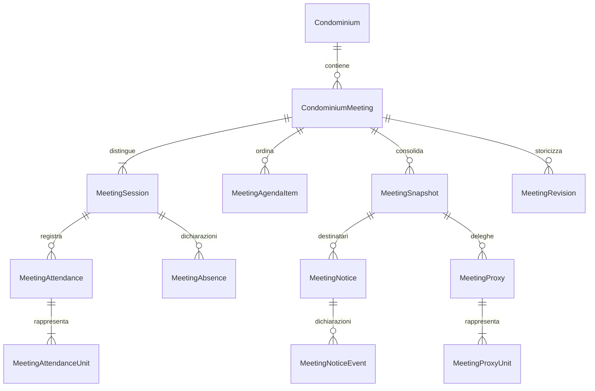

# Assemblee M07.1 — modello e convenzioni

## Confine funzionale

Gestione operativa fino a convocazioni, deleghe e presenze. Nessun voto, quorum,
delibera, approvazione automatica M06, invio reale, PDF o archivio documentale.
Le denominazioni degli stati sono applicative: non attestano adempimenti legali.

## Modello e relazioni

Tutte le nuove entità hanno UUID, TenantId, CondominiumId, audit temporale e FK
composite. I figli includono MeetingId nelle FK reciproche, impedendo anche
associazioni tra due assemblee dello stesso condominio. L'esercizio è opzionale:
un'assemblea può riguardare più bilanci tramite punti distinti dell'ordine del giorno.
Un esercizio chiuso può essere discusso senza modificare i suoi dati contabili.

MeetingService implementa IMeetingService: Domain contiene invarianti, Application
contratti e DTO, Infrastructure coordina EF e transazioni, API espone HTTP.
Nessuna dipendenza o libreria nuova. Nessuna tabella contabile viene modificata.

## Stati e concorrenza

Assemblea: Draft → Scheduled → Convened → InProgress. Cancelled ammesso prima
dell'avvio. Completed è riservato alla successiva gestione deliberativa: M07.1
rifiuta quella transizione. Non esiste conclusione automatica.

Ogni mutazione richiede ExpectedVersion. Un lock sul condominio serializza le
scritture, il token EF Version rileva aggiornamenti obsoleti e la transazione
salva dati, nuova revisione e audit. Retry con vecchia versione restituisce 409,
senza duplicare deleghe o presenze. La risposta contiene la nuova versione.

Ogni sessione First/Second ha un proprio UUID e stato Planned/InProgress/Ended/NotHeld.
La seconda è facoltativa, deve seguire temporalmente la prima e non parte da sola.
Prima di avviarla occorre registrare l'esito della prima. Una sola sessione può
essere in corso. Terminare una sessione richiede l'uscita delle presenze attive.
Date/ore persistite UTC, UI mostra il fuso locale. Nessun intervallo minimo legale
tra convocazioni è imposto senza regole verificate.

Titolo, luogo, date e ordine del giorno non sono modificabili dopo Convened.
La cancellazione fisica è esposta soltanto per punti dell'ordine del giorno prima
della convocazione e per la seconda sessione ancora modificabile. Le revisioni
ne conservano comunque il contenuto.

## Ordine del giorno e M06

Posizioni contigue da 1, univoche per assemblea; riordino richiede l'elenco completo
senza duplicati e usa posizioni temporanee nella stessa transazione.
RelatedType/RelatedId identificano Budget, FinalStatement o AccountingPeriod.
Il UUID del bilancio identifica la versione, senza cercare automaticamente una
versione corrente. Servizio e trigger PostgreSQL verificano tenant/condominio.
Una discussione non cambia lo stato amministrativo dei bilanci.

## Aventi diritto e snapshot

La data di riferimento è esplicita. Si riusano OwnershipPeriod e le loro date
inclusive, distinguendo associazione, persona e unità. Proprietari, comproprietari,
usufruttuari e Other sono potenziali partecipanti; Tenant non viene automaticamente
incluso. Titoli diversi dalla proprietà sono segnalati per la verifica futura per
argomento. Non si attribuisce oggi un diritto di voto generale.

Lo snapshot contiene unità attive o con titolarità efficace, codici, nomi, recapiti,
UUID delle associazioni, ruoli, frazioni, validità, rappresentante operativo,
tabella selezionata, quote decimal numeric(18,6), denominatore e anomalie.
Ogni unità conserva una sola quota millesimale: le frazioni di comproprietà non
moltiplicano o dividono automaticamente il suo peso assembleare.

Un solo proprietario con frazione 1 è il rappresentante operativo proposto.
Comproprietà, titoli concorrenti e situazioni ambigue richiedono scelta esplicita
tra i titolari storici. La scelta non è una prova di rappresentanza legale e non
risolve i futuri diritti per materia. Quote di proprietà incoerenti e millesimi
mancanti/duplicati sono segnalati; nessuna normalizzazione o dato stimato.

MeetingSnapshot è append-only, con versione, motivo, attore, data e fingerprint.
Il confronto delle fonti avviene su richiesta tramite anteprima; l'interfaccia
segnala le variazioni rispetto allo snapshot. Nessuna modifica anagrafica aggiorna
lo storico automaticamente. La riconciliazione crea un nuovo snapshot e conserva
i precedenti; richiede revoca delle deleghe attive ed è vietata dopo l'avvio delle
presenze. Se l'assemblea era Convened torna esplicitamente Scheduled: occorre
preparare convocazioni per i nuovi destinatari e consolidare di nuovo.

MeetingRevision conserva a ogni mutazione un secondo snapshot completo operativo:
assemblea, sessioni, agenda, versioni partecipanti, convocazioni con recapiti ed eventi,
deleghe con unità e presenze. Questi documenti immutabili ricostruiscono anche
l'evoluzione delle deleghe posteriori al primo consolidamento partecipanti.

## Convocazioni e recapiti

Destinatari distinti derivati dai titolari dello snapshot, non dall'intera rubrica.
L'operatore sceglie canale e recapito, eventualmente diverso da quello anagrafico,
che rimane congelato insieme al nome. Email/PEC sono validate sintatticamente;
la classificazione PEC non verifica l'effettiva natura del recapito.

Draft → Ready → Sent → Delivered/Failed; Draft/Ready/Failed possono essere annullati.
Un nuovo tentativo dopo errore crea un nuovo record, senza riscrivere il precedente.
Non esiste invio reale. Sent e Delivered sono dichiarazioni manuali, con data,
operatore, riferimento e note; VerifiedEvidence è sempre false. Non sostituiscono
ricevute PEC, postali o altre prove verificate. Il momento di preparazione è CreatedAt.

Convened consolida i dati operativi e richiede almeno una convocazione non annullata
per ciascun destinatario dello snapshot: non equivale a prova di invio o consegna.

## Deleghe e presenze

Delegante e delegato distinti; delegato è una persona attiva dello stesso studio,
anche esterna al condominio. Il delegante deve essere il rappresentante operativo
consolidato di ciascuna unità selezionata. Nomi storicizzati, data conferimento,
riferimento documentale e note sono conservati.

Draft → Submitted → Verified/Rejected; revoca da Draft/Submitted/Verified.
La verifica è manuale e riservata a StudioAdmin. Anche una delega in preparazione
riserva l'unità: prima di presenza diretta o altra delega occorre revocarla/rifiutarla.
Un indice univoco filtrato impedisce due deleghe attive per la stessa unità.
Nessun limite numerico normativo o subdelega automatica viene introdotto.

Ogni ingresso riferisce sessione e snapshot; ByProxy richiede una delega Verified
coerente, con PersonId del titolare e RepresentedById del delegato effettivo.
Le righe unità conservano le quote e hanno indice univoco filtrato per sessione:
non possono essere contemporaneamente presenti direttamente e per delega.
L'uscita libera la rappresentanza attiva senza eliminare l'ingresso. Un rientro è
un nuovo record. Una delega utilizzata non può essere revocata con presenze attive.
Le due sessioni hanno registri indipendenti. Remote richiede un URL HTTPS configurato.

Le assenze sono dichiarazioni append-only per soggetto/sessione con motivo: non
si deducono dall'assenza di ingressi. Un successivo ingresso resta distinguibile
cronologicamente dall'assenza dichiarata. La doppia rappresentanza è controllata
per unità, non impedendo che un delegato rappresenti più soggetti.

Totali presenti = persone fisicamente operative distinte (delegati inclusi);
quote = somma delle sole unità rappresentate attive, una volta ciascuna. Quote
mancanti restano anomalie dello snapshot e non vengono trasformate in quote legali.
I riepiloghi sono informativi e non costituiscono verifica di quorum.

## Sicurezza e database

Cookie Identity, membership attiva, TenantMember, CSRF e X-Expected-Tenant riutilizzati.
Viewer consulta assemblea e snapshot con recapiti oscurati; non riceve convocazioni,
recapiti, note riservate o revisioni complete. Collaborator gestisce le operazioni;
StudioAdmin verifica le deleghe. Gli audit tecnici contengono UUID/attore/azione/data,
mai recapiti o note personali. Le revisioni riservate contengono invece i dati di
business necessari allo storico e sono accessibili solo ai ruoli operativi.

Migration `20261106162359_MeetingsMilestone071`: dodici tabelle additive, FK Restrict,
indici, controlli di stato, snapshot/eventi/revisioni immutabili, controlli differiti
su sessioni e rappresentanze. Down bloccato per evitare perdita dello storico.
Nessuna migration automatica all'avvio o applicazione al database di lavoro.

## Limiti espliciti

Nessuna interpretazione automatica della normativa, limiti deleghe, quorum, voto,
subdeleghe, comproprietà o ripartizione dei diritti tra nudo proprietario e usufruttuario.
La scelta manuale del rappresentante è preparatoria, non un attestato giuridico.
Le anomalie sono esposte: la M07.2 dovrà decidere quali bloccano la specifica votazione.
Nessuna modifica di snapshot dopo l'avvio, né rettifiche arbitrarie delle presenze:
uscita e nuovo ingresso costituiscono lo storico controllato disponibile.
Liste non paginate; invii massivi, firma, allegati e prove di consegna sono futuri.

## Proposta M07.2 (non implementata)

1. Definire un catalogo esplicito e versionato dei criteri di voto per materia,
   con verifica delle regole applicabili e gestione manuale delle eccezioni.
   Non assumere una stessa platea per tutte le categorie dell'ODG.
2. Congelare per ogni votazione sessione, partecipanti effettivi a quell'istante,
   rappresentanze e criteri. Distinguere teste, unità e millesimi evitando duplicati.
   Gestire ingressi/uscite senza riscrivere votazioni già chiuse.
3. Implementare apertura, espressione favorevole/contraria/astenuta e chiusura
   delle votazioni con autorizzazioni, idempotenza e controlli di concorrenza.
   Produrre risultati ricostruibili con regola e versione utilizzate.
4. Modellare le delibere con snapshot immutabili e collegamento alla versione
   esatta dei bilanci M06. Il passaggio all'approvazione amministrativa deve essere
   esplicito, autorizzato e auditato, senza confondere delibera e stato del gestionale.
5. Verificare casi di comproprietà, usufrutto, deleghe, entrate/uscite, soglie,
   annullamenti e rettifiche con test puri, PostgreSQL ed Edge. Solo dopo questi
   controlli introdurre la conclusione dell'assemblea; PDF e archivio restano M07.3.
